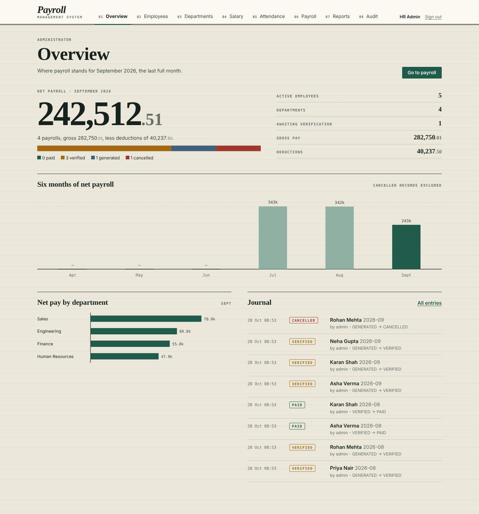
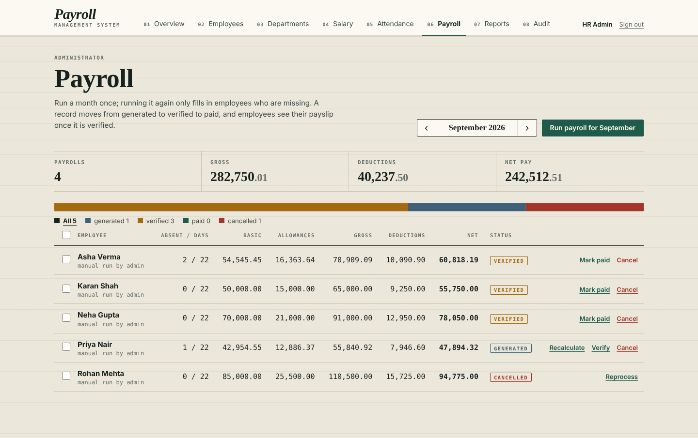
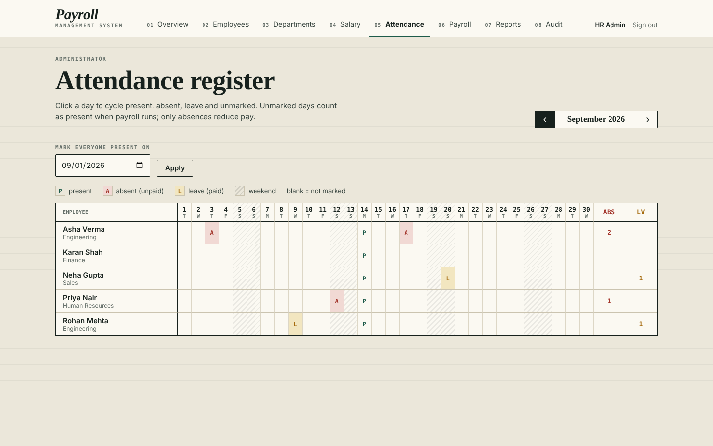
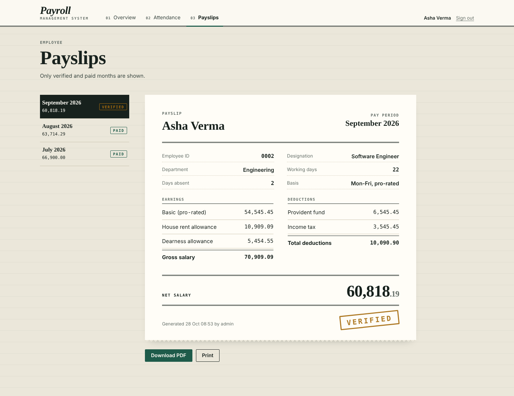

# Payroll Management System

A payroll application with a **Java backend** (REST API, JDBC, MySQL) and a hand-written **HTML / CSS / JavaScript front end**: no framework, no CDN, no build step.
It covers the monthly cycle from attendance to payslip: employee records, salary structure, attendance, payroll runs with a verify / pay workflow, audit trail, reports and PDF payslips.

| Admin overview | Payroll |
|---|---|
|  |  |
| **Attendance register** | **Employee payslip** |
|  |  |

## Quick start

1. Install JDK 17+ and MySQL 8 (MariaDB 10.5+ also works) and start the database server.
2. Tell the app how to connect. Edit `src/main/resources/db.properties`, or create `config/db.properties` next to where you run the jar:

   ```properties
   db.url=jdbc:mysql://localhost:3306/payroll_db?createDatabaseIfNotExist=true&useSSL=false&allowPublicKeyRetrieval=true&serverTimezone=UTC
   db.user=root
   db.password=your-password
   ```
   Other options: `-Dpayroll.config=/path/file.properties`, or env vars `PAYROLL_DB_URL`, `PAYROLL_DB_USER`, `PAYROLL_DB_PASSWORD`.
3. Build and run:

   ```bash
   mvn package
   java -jar target/payroll-system-1.0.0.jar
   ```
4. Open **http://localhost:8080**.

The first start creates the tables and demo data. Set `PORT` to change the port; the server listens on `127.0.0.1` only unless you set `PAYROLL_HOST=0.0.0.0`.

| Role | Username | Password |
|---|---|---|
| Admin / HR | `admin` | `admin123` |
| Employees | `asha`, `rohan`, `priya`, `karan`, `neha` | `emp123` |

Change these before using the system for anything real.

## What it does

**Admin / HR**: overview with a six-month trend and department chart; employees (add, edit, search, deactivate, reset password); departments; salary structure per employee; an **attendance register** (a month grid; click a day to cycle present, absent, leave); **payroll** (run a month, then verify, pay, cancel, reprocess, recalculate, singly or in bulk); reports with CSV download; an audit journal of every payroll action.

**Employee**: overview of latest pay and attendance; a personal calendar; **payslips** (only after HR verifies the month) with PDF download and print; profile and password change.

**System**: on the 1st of each month, while the server is running, the previous month's payroll is generated automatically (`AUTO`, user `SYSTEM`).

## How salary is calculated (`PayrollCalculator`)

```
working days = Monday-Friday days in the month
basic  = basicSalary x (workingDays - absentDays) / workingDays     (unmarked days count as present; LEAVE is paid)
hra    = basic x HRA%        da  = basic x DA%
gross  = basic + hra + da
pf     = basic x PF%         tax = gross x tax%
net    = gross - (pf + tax)
```
Defaults for a new employee: HRA 20, DA 10, PF 12, tax 5. Money is `BigDecimal` / `DECIMAL(12,2)`, rounded half-up to 2 places.

**Payroll status flow**: `GENERATED -> VERIFIED -> PAID`; `GENERATED / VERIFIED -> CANCELLED -> (reprocess) -> GENERATED`. PAID is final.
A run is one database transaction and idempotent (`UNIQUE(emp_id, pay_month)` plus skip-if-exists).

## Architecture

```
browser (HTML + CSS + ES modules)  --JSON over HTTP-->  web (Javalin routes)  -->  service  -->  dao  -->  MySQL
```

```
src/main/java/com/payroll
  web/      WebApp (start-up, headers, errors), Api (login, /api/me), AdminApi (/api/admin), Dto (what the browser may see)
  service/  AuthService, EmployeeService, DepartmentService, AttendanceService, PayrollService, PayrollCalculator,
            ReportService, PayslipService, PayrollScheduler
  dao/      UserDAO, EmployeeDAO, DepartmentDAO, SalaryStructureDAO, AttendanceDAO, PayrollDAO, AuditDAO  (PreparedStatements only)
  db/       DBConnection (HikariCP pool + transactions), DatabaseInitializer (schema + demo data)
  model/    Person (abstract), Employee, Admin, Department, SalaryStructure, Attendance, Payroll, PayrollAudit, Payslip
src/main/resources
  public/   index.html, css/ledger.css, js/ (main router, api, ui, charts, util) and js/views/ (one file per page)
  schema.sql, db.properties
```

### API

All JSON. Writes must send `X-Requested-With: XMLHttpRequest` (the front end does). Errors return `{ "error": "..." }`.

| Area | Endpoints |
|---|---|
| Session | `GET /api/session`, `POST /api/login`, `POST /api/logout` |
| Account | `GET /api/me`, `PUT /api/me/profile`, `POST /api/me/password` |
| Employee | `GET /api/me/overview`, `/api/me/attendance?month=`, `/api/me/payslips`, `/api/me/payslips/{yyyy-MM}`, `.../pdf` |
| Admin (role ADMIN) | `/api/admin/overview`, `/employees`, `/departments`, `/salary-structures`, `/attendance`, `/payroll`, `/payroll/run`, `/payroll/{id}/{verify\|pay\|cancel\|reprocess\|recalculate}`, `/payroll/bulk`, `/reports/{payroll\|attendance\|employees}[?format=csv]`, `/audit` |

### Security

- Passwords are BCrypt hashes; five wrong passwords lock the account for 15 minutes; deactivated employees are signed out on their next request.
- Session cookie is `HttpOnly` and `SameSite=Strict`; the session id changes on login; writes need the `X-Requested-With` header.
- Role checks happen on the server (`/api/admin/*` is admin-only; payslip endpoints are employee-only and show only verified or paid months).
- Responses carry a strict Content-Security-Policy (the front end has no inline script or style), `nosniff`, no-framing and same-origin referrer headers.
- All SQL uses `PreparedStatement`; the browser never receives entities (and so never a password hash); user text is HTML-escaped when rendered.

## Front end

No libraries. The look is a ledger: ruled paper, serif headings, monospace tabular figures, hairline tables, "stamp" status marks, a payslip drawn as a paper slip. Pages are ES modules loaded on demand by a hash router; charts are SVG written by `charts.js`; forms open in a slide-over drawer. It works down to phone width and prints a payslip cleanly.

## Tests

```bash
mvn test        # 27 tests on in-memory H2 (MySQL mode)
```
- `PayrollCalculatorTest`: the salary maths.
- `PayrollWorkflowTest`: services and DAOs end to end (login and lockout, payroll runs, status changes, payslips, reports, rollback).
- `WebApiTest`: the HTTP API as the browser uses it (auth, roles, CSRF header, no hash leakage, payroll to payslip, PDF, CSV).
- Against a real MySQL (tables in that database are dropped first!):
  `PAYROLL_TEST_URL="jdbc:mysql://localhost:3306/payroll_test?useSSL=false&allowPublicKeyRetrieval=true" PAYROLL_TEST_PASSWORD=secret mvn test -Dtest=PayrollWorkflowTest`
- `e2e/e2e.js`: drives the real UI in headless Chromium (needs a running server on a fresh database and `npm i playwright`).

## Notes on design choices

| Choice | Why |
|---|---|
| Salary is calculated in Java only (`PayrollCalculator`), audit rows are written in the same transaction | One source of truth; testable without a database |
| Scheduler runs inside the server instead of a MySQL Event | Works without special DB privileges; HR can always run payroll manually |
| Integer ids, one `users` table shared by admins and employees | Simple joins; `employee.emp_id` is `users.id` |
| No front-end framework | Nothing to install or build; the whole UI is readable source |
